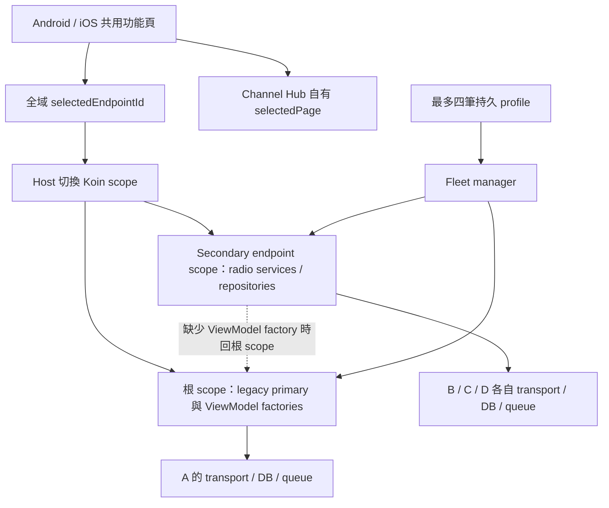
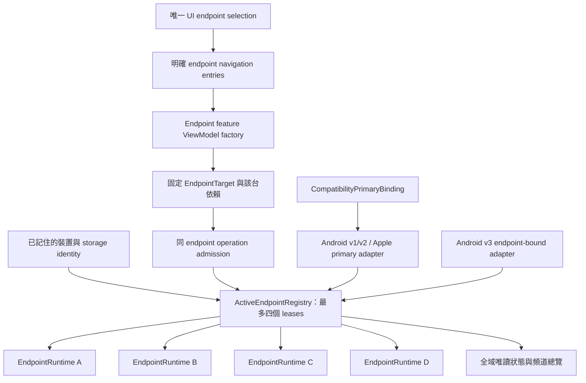

# NTsocial MeshLink Android／iOS 四節點架構調查與重構提案

日期：2026-10-15（Asia/Taipei）  
調查基準：`e7482d9e893ef59eeafce9c8fa90c1fa7f7afd0c`，調查開始時工作目錄乾淨。  
狀態：**設計提案，尚未實作**。本次只新增文件與工作記憶，沒有修改產品程式碼、安裝 App、操作無線電或執行產品建置。

## 1. 結論與建議決策

使用者指出的三個問題有實際架構依據。目前系統已具備真正的 secondary endpoint 隔離：獨立 Room、設定 DataStore、BLE／封包處理圖、session 與訊息佇列；但 UI 與生命週期仍混合「單一根 radio」及「多 endpoint」兩套模型。

最關鍵的發現如下：

1. **第一台不能釋出名額是明文設計限制。** 四台上限計算已儲存 profile 的數量；disconnect 只停止 session，第一台又被標為不可移除的 `legacyPrimary`。這與使用者要求的「中斷連線就釋出名額」相反。
2. **第二台設定仍指向第一台，有可重現的 DI 機制。** endpoint scope 註冊了 radio repositories，卻沒有註冊 radio 頁面的 ViewModel factories。`scopedViewModel()` 雖然使用不同 key，Koin 4.2.1 仍會到根 scope 找 ViewModel factory，並在根 scope 解析其依賴。不同 ViewModel instance 不等於不同 radio owner。
3. **左下角 Channel Hub 的節點篩選，不等於全 App 操作目標。** 它只改自己的 `selectedPage`，沒有同步 fleet selection；它也沒有直接開啟該節點 Channels 管理／QR 的入口。其他頁面的 scope 取決於全域選取與所在分頁，route 本身大多不帶 endpoint。

**建議採取漸進重構：保留 radio／資料隔離，重建 endpoint 控制邊界。** 核心是分離「記住的裝置、最多四個執行中連線名額、目前 UI 目標、Gateway 相容主節點」，並讓每個資料頁、ViewModel、非同步操作都持有明確且不可偷偷改變的 endpoint owner。

不建議只刪除 primary 的移除限制、只增加頁籤、只改 ViewModel key，或整批重寫 BLE／Meshtastic 協定。前三者不能修復完整 ownership；最後一者會浪費已存在的隔離成果並擴大風險。

## 2. 調查方法與證據界線

- 追查 Android、iOS、共用 fleet／navigation／settings／messaging／QR 的 production call chain，並檢閱相關測試及 CI inventory。
- 查閱根目錄 `AGENTS.md`、`.skills/project-overview/SKILL.md`、`.skills/kmp-architecture/SKILL.md`、`.skills/navigation-and-di/SKILL.md`；舊記憶僅作背景，結論以本次 source 為準。
- 對本機快取的 **Koin JVM 4.2.1** 反組譯，並在 repository 外執行最小依賴解析實驗，驗證 root factory fallback。這是依賴解析機制的執行證據，不是 Android Compose 或 iOS Kotlin/Native 裝置測試。
- 沒有使用者手機的此次 APK 雜湊、build flavor、build revision 或操作錄影；**不能宣稱已確認手機安裝檔就是上述 HEAD，也不能把所有點擊症狀都宣稱已在裝置重現**。
- 本次未重跑 Gradle／Xcode。既有測試的存在不代表本次執行通過；歷史雙節點／RF 證據也不能證明四台同時操作及本次 UI 路徑。

證據標籤：**確認**＝本次原始碼或小型依賴實驗可直接證明；**推導風險**＝呼叫鏈缺乏必要邊界，尚未完成 UI／硬體重現；**待測**＝必須由指定 artifact 與裝置場景確認。來源索引見第 12 節。

## 3. 現有架構及問題定位

### 3.1 已存在、應保留的基礎



Android factory 對 primary 建立 root radio facade，對 secondary 建立獨立 database handle、coroutine scope、DataStore 與 Koin scope（[S03](#s03)）。iOS 也採相同的 primary／secondary 分工（[S13](#s13)）。這表示「有四台連線基礎」與「所有 UI 已正確控制四台」是不同的完成條件。

### 3.2 F01：名額等於 profile 數量，第一台被永久綁在相容角色

**確認，直接解釋問題 1。**

```text
第一次 register(A)
  → current.isEmpty()，A.legacyPrimary = true
  → profiles 保存 A
使用者 disconnect(A)
  → manager.disconnect(A)
  → session.stop()
  → profile 仍存在；enabled / autoConnect 不變
再次新增裝置
  → 檢查 current.size，而非執行中的連線數
嘗試 remove(A)
  → manager 明確拒絕 legacyPrimary
```

- Store 在 `register()` 以 `current.size >= 4` 拒絕新增；`normalizeProfiles()` 又截取最多四筆並強制非空清單有 primary（[S02](#s02)）。
- Manager `disconnect()` 只有 `session?.stop()`；`remove()` 拒絕 primary，`setLegacyPrimary()` 也拒絕轉讓（[S01](#s01)）。
- Android／iOS fleet card 都隱藏 primary 的 Remove（[S04](#s04)）。既有 manager test 還要求 primary 不可移除（[S20](#s20)）。
- `autoConnect` 預設為 true；`start()` 會啟動所有 enabled + autoConnect profiles，手動斷線沒有留下持久的「不要再連」意圖（[S01](#s01)、[S02](#s02)、[S23](#s23)）。

**不能直接把 disconnect 改成現有 remove。** Store.remove 會自動把另一台升成 primary；manager 會因角色變化關閉／重建 graph；primary facade 的 `close()` 卻只關閉 observer，沒有關閉 root transport（[S01](#s01)～[S03](#s03)、[S13](#s13)）。這可能讓 B 的 profile 接到仍屬於 A 的根 graph，也可能打斷 B 的既有 session。

### 3.3 F02：endpoint scope 有 repository，沒有同一 scope 的 ViewModel factory

**確認 DI 結構與 JVM 機制；高度吻合問題 3，但未在使用者 artifact 重現完整 UI。**

設定頁使用 `scopedViewModel<RadioConfigViewModel>()`。該 helper 取得 `currentKoinScope()`，只將 scope ID 加到 ViewModel key，再呼叫 `koinViewModel(scope = scope)`（[S06](#s06)、[S07](#s07)）。

然而 Android `radioEndpointKoinModule` 與 iOS `iosRadioEndpointKoinModule` 都沒有 ViewModel factory definitions；`RadioConfigViewModel`、`ChannelViewModel` 等仍透過 root component scan／`@KoinViewModel` 註冊（[S05](#s05)、[S07](#s07)、[S14](#s14)）。

本機 Koin 4.2.1 的解析路徑是：

```text
secondaryScope.get(ScreenModel)
  → secondary 找不到 ScreenModel definition
  → CoreResolverV2.resolveFromLinkedScopes 找到 root definition
  → newContextForScope(root)
  → root factory 的 get<RadioRepository>() 解析到 primary repository
```

最小實驗結果：

```text
Direct secondary repository: B-secondary
Root-defined screen factory requested from secondary scope: A-primary
Factory creation scope: _root_
```

因此畫面可以有 B 的外層頁籤、B scope 的 ViewModel key，實際 constructor dependencies 卻仍是 A。**只檢查 repository 隔離、只檢查 VM instance 不同，都不足以驗收。** 每個 radio-owned ViewModel 及其間接 use case 必須真的在 endpoint graph 內建構，或明確接收該 endpoint 的 typed dependency bundle。

這個結構也涉及訊息、Nodes、Channels、QR、韌體等 root-defined radio ViewModel，不應把修補範圍只限於 Settings；各頁實際讀／寫錯目標的行為仍要逐項建立回歸案例，不能由本實驗推稱已發生錯誤 RF 發送。

### 3.4 F03：兩套選取狀態，且頻道總覽缺少管理入口

**確認，直接解釋跨頁選取不一致及 QR 入口缺失。**

- 最左方的 top-level 是 `Conversations → ContactsGraph`，Android／iOS 以 `FleetChannelsEntryContent` 替代原清單（[S08](#s08)、[S24](#s24)）。
- 點 Hub 的 B 分頁只執行 `FleetChannelsViewModel.showEndpoint(B)`，更新私有 `selectedPage`；沒有 `fleetManager.select(B)`（[S08](#s08)）。所以隨後進設定仍可能以之前的 A 為目標。
- Hub 的 callback 只有開啟頻道對話、完整對話清單及外觀編輯。頻道列走 `FleetMessages`，不是 `ChannelsRoute`；卡片沒有 `Manage channels`／`Scan QR` action（[S08](#s08)）。QR 功能在另一個 `ChannelScreen` 裡（[S11](#s11)）。
- 現有**間接入口仍存在**：`EndpointContacts(B)` → 舊 Contacts 頁的 Import/Share action → `ChannelsRoute.ChannelsGraph`。但該 action 取決於 ContactsViewModel 的 Connected 狀態；它同樣受 root factory fallback 影響。因此 A 離線、B 在線時，B 的頁面可能因看到 A 的狀態而隱藏入口（[S26](#s26)）。這是需要重現的具體路徑，不是相機硬體故障的證據。
- Hub 本身的 endpoint filter 有正常的 source 路徑；不能僅憑上述問題斷言「B 的分頁 onClick 完全失效」。若使用者連篩選後的 B 卡片也看不到，還需檢查實際 artifact、source registry readiness 與 UI 重現。

### 3.5 F04：大部分 route 沒有 endpoint，scope 隨全域狀態與所在分頁改變

**確認缺少 ownership；具體錯頁／重設時序屬待測。**

`FleetMessages`／`EndpointContacts` 已攜帶 endpointId + generation；但 Channels、Settings、LoRa、NodeDetail 等 route 沒有 endpoint（[S09](#s09)）。Host 以 `selectedEndpointId` 包住整個 NavDisplay，而不是從每個 entry 的 owner 建立 scope（[S10](#s10)、[S12](#s12)）。

造成下列不一致：

1. 點 endpoint tabs 時，只重設當前 top-level stack。其他分頁仍保留無 endpoint 的子頁；之後回去會在新的全域 scope 下解讀舊 route。
2. 從 Connections fleet card 改選取，只改 fleet selection，沒有同樣的 stack reset。
3. `featureScopeMode` 對 Connections 一律選 ROOT，即使它的 stack 後來壓入設定／NodeDetail。`ConnectionsNavigation` 的 callback 確實會把這些子 route 加進同一 stack（[S27](#s27)），而 route 無法證明自己應屬哪台。
4. `EndpointScopeHost` 在 render 的 effect 內主動 `select(endpointId)`。已保存的對話 entry 可以回頭改變全域選取；多 pane、返回與快速切換尤其需要驗證。
5. Android `selectedSnapshot == null` 與 iOS 類似分支會退回 root rendering。當使用者要看的 endpoint 消失時，安全行為應是明示不可用，而非顯示另一台。

`scopedViewModel` key 是必要的防重用措施，但不能解決 route、SavedState、編輯草稿、dialog 與 constructor dependency 的完整 owner 問題。

### 3.6 F05：QR／外部匯入還有 root dialog 與非同步 callback 邊界

**確認結構缺口；尚未觀察到錯節點寫入。**

- `ChannelScreen` 有 scanner，掃描結果送入 `ChannelViewModel`；但 `ScannedQrCodeDialog` 預設使用普通 `koinViewModel()`，不是 endpoint-qualified factory/key（[S11](#s11)）。只修 ChannelViewModel 仍可能留下 QR apply 的錯誤依賴。
- `MeshtasticAppShell → SharedDialogs` 使用 root `UIViewModel` 的 connection／匯入狀態。外部 URL 匯入沒有攜帶目標 endpoint，不應直接在 root radio 上套用（[S15](#s15)）。
- iOS `rememberUpdatedState(onResult)` 在完成時讀取最新 callback；pending request 只有 request ID 與 callback，沒有 endpoint/session ownership。Swift `didAdd` 沒有檢查 `activeScanner === dataScanner`，而 unavailable callback 有檢查（[S16](#s16)）。舊 scanner 的遲到結果需要專門測試。

### 3.7 F06：全 App 狀態仍偏向 primary，驗證也沒有涵蓋整條 UI 控制鏈

**確認。**

- Navigation suite 的連線狀態、未讀數、裝置位址來自 root `UIViewModel`；Connections 同頁又同時有 fleet panel 與單 radio status／disconnect card（[S15](#s15)、[S17](#s17)）。B 已 Ready 不代表底部連線指示會反映 B。
- `connectInternal()` 的全域 bootstrap mutex 包住完整 `session.start()`；start 可等待 READY 最多 90 秒。一台啟動失敗會阻擋別台 bootstrap，雖然不代表其他已 Ready 的 radio 被停止（[S01](#s01)、[S03](#s03)、[S13](#s13)）。
- 既有 Android secondary production test 檢查 repositories、Gateway queue 與 DB 隔離，沒有經由 production factory 建構 Settings／QR 等 ViewModel；navigation assembly test 只查 entry 是否存在（[S18](#s18)）。
- CI 明列 shards 缺少 `core:radio-fleet` 等模組；root smoke module list 沒有直接列它；iOS native test link/run 被 convention 關閉（[S19](#s19)）。編譯成功不能證明 secondary UI 真的操作 secondary radio。

### 3.8 F07：root radio 的啟動與 Android service 存活，繞過 fleet 名額模型

**確認，是讓 primary 真正可釋放時必須同步處理的 production 路徑。**

Android `MeshService.onCreate()` 先啟動 root orchestrator，再啟動 fleet manager；iOS composition root 也先啟動 root durable queue／orchestrator。`MeshServiceOrchestrator.start()` 會自行 hydrate legacy address、切 DB、載入 node cache，再直接呼叫 root `radioInterfaceService.connect()`（[S28](#s28)）。因此只在新的 fleet store 寫入「A 不要連」仍不夠：舊 root 啟動路徑也必須受同一 intent／lease admission 管理。

另一方面，Android `MeshService.onStartCommand()` 的延後 STOP 判斷依 root radio 的 device address，而非整個 fleet（[S28](#s28)）。若釋放 A 時清空 legacy address，現有路徑又可能把仍服務 B/C/D 的 host service 停掉。重構必須同時解除「host 啟動必連 primary」與「primary 無地址就停整個 host」兩個假設。

## 4. 要交付的使用者行為

「節點」需區分兩種概念：上方選取的是手機直接連線的 **radio endpoint**；Nodes 頁內顯示的是從該 radio 看到的 mesh nodes。遠端節點的 `destNum` 不是手機的 endpoint ID。

| 情境 | 新行為／驗收標準 |
| --- | --- |
| A、B、C、D 都佔用連線名額，按 A「中斷連線」 | A 的 transport、重連及操作權完成撤銷後，顯示 3/4；A 從目前連線清單移出。E 可連線。A 不因重啟 App 或遲到 restoration 自動佔回名額。 |
| 無線訊號短暫消失 | 顯示「重新連線中」，可暫保留原名額供自動恢復；使用者仍能明確中斷並釋出。這與使用者按中斷的意圖分開。 |
| 想再連 A | 在「已記住的裝置」或掃描清單選 A，重新申請名額；沿用既有 endpoint ID、設定及歷史，不產生假新裝置。 |
| 在頻道頁選 B，再進 Nodes／設定 | 所有 endpoint 功能頁明示 B 的名稱、短識別碼、連線狀態，沿用相同 UI 目標；不需要去 Connections 再選一次。 |
| 在 Hub 點 B 的「管理頻道／掃描 QR」 | 直接開 B 的 Channels 管理及 scanner，預覽與套用始終綁 B；顯示 B 的現有頻道及 RF 設定。 |
| 在設定 LoRa 子頁切 A→B | 保持在 LoRa 類型頁面並載入 B 資料；A 的未送出草稿按 endpoint 保存或明確提示處理，絕不把草稿送 B。若 B 不支援該功能，顯示原因。 |
| 在某 mesh node 詳情／DM 切換 radio | 不以相同 nodeNum/contactKey 猜測另一個 radio 的對象；回到 B 的 Nodes／對話根頁，由使用者選擇。 |
| 正在 A 上執行已受理的頻道變更，改看 B | 已受理工作仍屬 A，按既有 exact-session contract 完成或保持待驗證；B 只改變 UI。 |
| A 是 Gateway 相容主節點，使用者斷開 A | 名額照樣釋出；Android v1/v2、Apple Gateway 對外呈現既有 not-ready／非 READY 語意，撤銷 A 的路由；其他 radio 保持運作。 |
| 「全部」總覽、App 語言／外觀、連線管理 | 保留清楚的全域語意；radio 寫入前必須選單一 endpoint。「全部」不能直接套用頻道／頻率到四台。 |

所有 radio 功能頁都能看見一致的 endpoint selector。Scanner 相機呈現時不必疊上可切換 radio 的控制；其標題／返回確認頁必須顯示固定目標，換目標會使尚未受理的掃描／預覽失效並要求重開。

## 5. 目標架構

### 5.1 將四種責任分離

以下為建議名稱與契約，**不是現有已實作 API**。

| 元件／模型 | 責任 | 不應承擔的責任 |
| --- | --- | --- |
| `RememberedRadioCatalog` | 穩定 endpoint ID、transport identity、display name、storage locator、重連偏好；允許多於四筆歷史裝置 | 不決定目前佔用名額，不因離線刪歷史 |
| `ActiveEndpointRegistry` + `ConnectionLease` | 原子配置最多四個 active/connecting/reconnecting/releasing 名額，管理 runtime lifecycle 與 admission | 不把第一台永久保留，不以 UI 選取切換 transport |
| `EndpointRuntime` | 該台 BLE、Room、config、node cache、queue、ingress gate、operation locks、明確 feature dependencies | 不從 root 取得另一台 radio repository；不擁有其他 endpoint |
| `EndpointUiSelection` | 唯一可供 UI 使用的選取 endpoint；Hub 的 All 另外作為總覽模式 | 不是 command routing authority，不改 Gateway owner |
| `CompatibilityPrimaryBinding` | Android v1/v2、primary-only Apple Gateway 及既有 primary host services 的相容角色，允許沒有 active runtime | 不佔名額，不自動升級 B，不等同「第一張卡片」 |
| `EndpointOperationCoordinator` | 接受已捕捉的 target/session、檢查 capability/readback、協調已受理命令及 disconnect | 不在執行時重新讀目前 UI selection 改派工作 |



### 5.2 所有 radio-owned 路徑使用明確 target

概念型別：

```kotlin
// 設計示意，非可直接套入的 patch。
EndpointTarget(endpointId, runtimeInstanceId, sessionEpoch)
EndpointDestination(endpointId, feature, childRoute, optionalRemoteNode)
EndpointOperation(target, operationId, expectedConfigRevision, payload)
```

- `endpointId` 表示裝置／歷史身份；`runtimeInstanceId` 表示本次建立的 graph；`sessionEpoch` 表示 transport session。它們不能互相取代，更不能以卡片索引或 BLE 位址最後四碼代替。
- Navigation 可持久化 endpoint ID 與頁面，**不能把還原後的舊 session token 視為有效授權**。process restart／重連後先重新解析 runtime，再重新讀取資料；舊 QR 預覽、未送命令及過期 target 不可直接重播。
- 每次寫入在 endpoint operation boundary 再驗證 target、readiness、目的 mesh node、config/channel identity。檢查失敗明示 unavailable/stale；禁止 fallback primary。
- 所有訊息／頻道／遠端 node 子路由保留 endpoint；即使兩台有相同 channel slot 或 nodeNum，也不會失去來源。

### 5.3 UI scope 由 entry 決定，ViewModel 的依賴由 endpoint factory 決定

保留 Compose Multiplatform、Navigation 3、`MeshtasticNavigationSuite` 與 `MeshtasticNavDisplay`。改掉的是其 ownership 組裝方式：

1. `EndpointNavigationCoordinator` 統一處理 selector、Hub 卡片、Connections、通知、deep link、返回及 saved-state restore。
2. 每個 radio entry 攜帶 endpoint ID，渲染時解析 `EndpointRuntimeRegistry.require(target)`；缺少 owner 就顯示不可用，不渲染 root 替代品。
3. 每個 radio ViewModel 使用 endpoint-local factory；其 radio repository、controller、queue、use case 均從同一 runtime 明確取得。App-global theme、locale、file picker 等依賴另列允許清單。
4. 過渡期可在兩個 host 的 endpoint module 註冊完整 feature factories；最終以共用 `EndpointFeatureDependencies`／factory 契約消除兩份手寫清單漂移。勿僅加 `viewModelOf` 而忽略其 use case 仍從 root 解析的情況。
5. VM owner key 至少包含 endpoint ID + runtime instance + feature/entry identity；editor／QR preview 額外綁 session／config revision。UI 保存的草稿可獨立於 session，但再次送出必須重新驗證。
6. root graph 只保留 app-global ViewModel 與明確相容 adapter。radio VM 的唯一入口是必要的、endpoint-owned `EndpointFeatureFactory`，從 typed dependency bundle 建立 VM 並驗證 target/owner；入口不再呼叫可向 root fallback 的通用 VM lookup。如此缺少某項 factory 才能真正失敗，單純補目前缺少的 registrations 不會自動達成此效果。

**導覽狀態政策：** 保留各 top-level 的 Navigation 3 backstack，將 radio entry 加上 owner；初期不保留每台完整子堆疊，沿用現有「換 endpoint 清理舊子路徑」原則。協調器以明確映射重建新 endpoint 的同類功能根頁：LoRa→B LoRa、Channels→B Channels、訊息／遠端 NodeDetail→B 對話／Nodes 根頁。所有受影響的 inactive stacks 同步驗證或清理。可另存每台的清單捲動與未送草稿，不恢復過期命令或 dialog。

新增 route 型別時同步更新 `TopLevelDestination.fromNavKey`、Navigation saved-state serialization、entry provider、deep-link router 及 parity tests。舊版還原的 endpoint-less 子 route 無法證明 owner，應回到選定 endpoint 的安全功能根頁，不能猜 primary 或直接還原可提交的 editor。

Windows 需要明確的 single-radio route/context adapter，讓 shared feature entry 解析到既有唯一 radio；不能要求目前 no-op fleet repository 提供不存在的 endpoint。該 adapter 不新增 Windows 四台功能或 parent IPC。

### 5.4 明確的功能歸屬表

| 功能 | 資料／控制 owner | 切換策略 |
| --- | --- | --- |
| 頻道 Hub All | 全域唯讀、每筆保留 endpoint | 卡片操作直接帶來源 target |
| endpoint 頻道、公開／私人訊息 | endpoint PacketRepository／queue | 同 slot/contactKey 不可跨台沿用 |
| Nodes／metrics／remote admin | endpoint NodeRepository + 遠端 node ID | 換 endpoint 回新台 Nodes 根頁 |
| Channels、LoRa、裝置／module 設定 | endpoint config + controller + locks | 同類頁重載，草稿不得搬到另一台 |
| QR 掃描／預覽／套用 | 一次請求的固定 endpoint/session owner | 失效即終止尚未受理的預覽 |
| firmware、log、清理 DB、匯入／匯出 | endpoint capability + repository | 每頁逐一接線；iOS 未支援功能仍隱藏／fail closed |
| Connections 掃描、配對、四台管理 | 全域 manager，操作明確指定 endpoint | 清除重複的 primary 控制語意，保留 BLE-only UX |
| 語言、主題、App 資訊、同意紀錄 | App-global | 切換 radio 不改動 |
| 通知、widgets、phone location | 維持現有 Android primary boundary，透過明確 adapter | 本案不默默擴成向所有 radio 發送 |
| Gateway | 按版本／平台的既有 owner 契約 | UI selection 永遠不切換 Gateway owner |

### 5.5 中斷並釋放的狀態機

```text
Remembered（不佔名額）
  → AcquireLease（原子保留一個名額）
  → Connecting → Synchronizing → Ready
  → 暫時斷線：Reconnecting（仍可保留 lease）
  → 使用者中斷：Releasing → Remembered（釋出名額）
```

手動中斷必須是同 endpoint 的可重入操作，依序處理：

1. 原子記錄 `desiredConnection = Disconnected` 與遞增 lifecycle intent version；停止該台 reconnect／restoration admission，不能等下一次正常 shutdown 才保存。
2. 將該台標成 Releasing，撤銷新 command admission、Gateway routes、scanner／尚未送出的 UI operation tokens；其他台不受影響。
3. 同步 fence 舊 callback/session generation，再依現有 quiesce 契約等待已受理的工作進入可保存狀態。不得在短 `ChannelOperationLock` 中等待必須取得同一鎖的 readback producer。
4. 斷開該 transport；對 ingress、drain、status/log、source publisher 與 scope child jobs 執行 cancel 並 await/join，不能只呼叫 `serviceScope.cancel()` 就繼續。完成有界等待後解除 source registry／scope references，再釋放 DB handle pin／DataStore runtime resources。
5. 確認 radio transport 已退出後釋出 lease，更新 active snapshots 與 UI selection；保留 remembered identity、歷史、ledger 及尚待處理的 durable rows。

**失敗策略：** teardown 使用有界等待，逾時時 fence callback、停止該 endpoint owner 並顯示可重試的「中斷未完成」。在平台尚未確認連線釋放前不能假稱可建立第五條 BLE 連線，也不能為了清 A 一次停掉 B/C/D。正常路徑需在真機訂定並驗收可接受的釋放延遲；異常路徑要有診斷及復原，不能永久顯示無限 spinner。

**Host bootstrap／存活：** 將 host service 初始化與 radio 啟動分開。Android service recreation／`START_STICKY`、root orchestrator、iOS composition root 及 restoration 的所有 connect／drain 路徑，都必須先取得同一 endpoint 的 intent／lease 授權。Android host 是否繼續工作以整體 active leases 及必要 host work 判斷，不能只看 primary address；foreground-service location type 仍依既有 primary phone-location opt-in／permission 契約，不因 fleet 擴大權限。

**Durable queue：** 明確中斷後停止自動發送；尚待 drain 的資料仍屬原 endpoint，可標為暫停。已取得 QueueStatus／已送出／已送達的列不能降級成待送；結果未知時保留既有待驗證／重試契約，不能盲目重送。重新連該 endpoint 後，只有通過既有身份、session 與 channel readback 驗證才能恢復。不能把 A backlog 移到 B，也不能把尚未驗證的操作宣告成功。已通過 Gateway local acceptance 的列及 idempotency ledger 不得因釋放名額消失。

**不要直接全域改 `disconnect()` 的意思。** Scanner 的 pairing/retry 流程也會先 disconnect 再 connect（[S25](#s25)）；必須分成內部 `stopTransportForRetry` 與使用者 `disconnectAndRelease` 等明確 intent，逐一遷移 caller，避免配對流程意外刪掉自己的 lease。

另設 `stopForHostShutdown`：App／host 正常結束可釋放 runtime 資源，但不等於使用者取消下次連線的意願；保留 desired connection。只有使用者明確 release 才持久改成 Disconnected。iOS 單純進背景不應無條件套用 shutdown，仍遵守現有 Kable／CoreBluetooth lifecycle。

### 5.6 Gateway 主角色與名額分離

採取保守且可施工的預設：**本次不自動轉讓 Gateway owner。**

- A 的 `CompatibilityPrimaryBinding` 可在 A 斷開後保留於 remembered catalog；A 不在 active list、不佔名額。A 不存在 active runtime 時，adapter 回傳各版本既有的 not-ready／非 READY 狀態，不把 B 當 A。
- **既有 accepted-ledger replay 是例外，不受新 radio admission 的 readiness gate 阻擋。** Apple Gateway 對已驗證且 fingerprint 相同的既有 ACCEPTED 請求，仍先查 private ledger、回傳原 packet ID，不重新送 radio；相同 client ID 不同內容維持 `IDEMPOTENCY_CONFLICT`。目前此處理在 route resolution 前（[S29](#s29)），A detach／process restart 後仍須保留。Private ledger 及必要 mailbox 處理不能隨 endpoint scope 一起刪除。
- Android v1 path、column、command/value 完全不變；v2 契約及 stable history cursor 不變。v3 繼續以 endpoint-bound source、route token、ledger key 操作各自 repository／queue。
- iOS 只有明確的 legacy-primary binding 可成為 Apple Gateway owner；B/C/D 的 standalone UI 能完整控制，不代表它們可發布 Apple Gateway。App Group、Keychain、HMAC、私有 ledger、exact session 及 route TTL 等契約維持。
- A 釋放後要容許 B/C/D/E 四台 standalone 連線，不能為相容 adapter 保留一個空名額；root graph 不得暗中仍握著 A 的 BLE。
- 若未來要求更換 Gateway 主節點，另做明確操作與遷移：撤銷舊 routes／publisher、保存舊 ledger domain、停止舊 owner、驗證新 endpoint readback、建立唯一 owner、重新 issue routes。不能利用 Store.remove 的自動 promotion 完成。這不是修復本次三項問題的前置要求。

### 5.7 QR 與一般非同步操作的完整所有權

Scanner request 保存 `{requestId, endpointId, runtimeInstanceId, sessionEpoch, screenOwner}`。Native 完成 callback 必須驗證自己的 scanner instance/request ID；Kotlin callback 必須比對 captured target，而不是取得完成當下的 UI 目標。

預覽會明示「套用至 B」，以 B 的最新 channel/LoRa context 計算差異；確認時再次進入 B 的 operation admission。切頁可以離開已受理工作，但 B 被釋放／session 換代後，舊的未受理預覽不得再送。外部 QR URL／deep link 沒有 target 時先提供 endpoint picker；不能以 root primary 補空值。

保留現有頻道可靠性契約：`validate/ensure → invalidate ingress → exact-session mutation → fresh correlated readback → activate`；沉默／timeout／重啟／context loss 是 `VERIFICATION_PENDING`，不是成功或明確拒絕。保留 primary/LoRa／既有 secondary slots 的 QR replacement 規則，null LoRa intent 不送 `set_config`。Android built-in provisioning 與 iOS verified provisioning 不合併成假共通流程。

## 6. 資料遷移、升級與回復

這次重構不需要把四台資料混成一個 DB，也不應變更 Meshtastic protobuf 或先改 Room packet schema。

1. **版本化 fleet catalog。** 把目前 `radio_endpoint_profiles_v1` 遷移為獨立 remembered catalog、connection intents 與 compatibility binding。使用同一個持久化交易／原子更新，保留舊值供診斷及受控 rollback。
2. **保留原 endpoint UUID。** secondary config DataStore 與 v3 ledger 可能使用 endpoint ID；既有 DB 使用 transport-address-derived locator。建立明確 storage locator mapping，重連沿用；不為了釋放 quota 刪 profile 再產生新 UUID（[S02](#s02)、[S03](#s03)、[S21](#s21)）。
3. **保留 cursor 身份。** 原 DB 的 history_epoch、change_seq、stable source identities、origin_client_message_id、Gateway ledger 不重寫、不合併。斷開不是 history reset。現存 live-clear epoch defect 不在本提案中被視為已修復。
4. **primary 不隨 active membership 自動正規化。** 移除 `.take(4)` 對 remembered catalog 的截斷，把 quota 移到 lease admission；取消「非空 active catalog 必有 primary」與 remove 自動 promotion。
5. **舊資料無法還原未記錄的手動斷線意圖。** 舊 autoConnect=true 不代表使用者現在想連線。升級首次以一次性的四台清單讓使用者確認欲恢復的連線；未確認者保持 remembered，不猜測歷史 intent。其後每次中斷持久記錄 intent。
6. **程序中斷恢復。** Active leases 是 runtime resource；重啟時根據持久 desiredConnection、最新 intent version、平台 restoration 身份及四台 quota 重新 admission。release intent 優先於舊 callback／舊還原資料。
7. **回復策略。** 切流先以內部 feature flag 驗證讀取/UI，可回到舊路徑但不允許兩個 graph 同時擁有同一 BLE。遷移到多於四筆 remembered profiles 後，不能直接讓舊 `.take(4)` reader 重寫新 catalog；舊版本 downgrade 必須使用相容快照或被明確阻止。不能靠清除 App 資料作為正式 rollback。

「忘記裝置」、「刪除本機歷史」、「解除 OS 藍牙配對」是不同操作。使用者這次要求的是中斷與釋出名額，並不授權這三種資料破壞；新 UX 應將它們獨立處理。

## 7. 施工流程與可獨立審查的工作包

下列順序讓診斷可以先重現，UI 可以先解除錯誤依賴，而完整名額釋放在相容邊界完成後落地。每個工作包都應有明確出口；不能把「新增頁籤」單獨當作完成。

| 階段 | 主要修改範圍 | 具體施工 | 出口條件／依賴 |
| --- | --- | --- | --- |
| P0：固定重現與 owner 契約 | app／ios runtime production graph tests、navigation tests、現有 fleet tests | 記錄目前 artifact；建立 A/B 不同 config、node、history sentinel；用 production VM factory 重現 root fallback；補「A 釋放後 E 可連」預期測試；建立功能 ownership 清單 | 先有失敗測試與修復目標。替換 primary 永不可移除的舊預期，保留 Gateway 不可任意轉讓的預期。 |
| P1：修正 feature DI | `RadioEndpointKoinModule`、`IosRadioEndpointKoinModule`、feature factories、`ScopedViewModel`、QR dialog | 加入完整 endpoint-local radio ViewModel factories；透過必要的 endpoint-owned factory/bundle 入口排除 root fallback；逐一追查 use case 間接依賴；明確傳 QR VM；檢查 Android/iOS production registration | B Settings／Channels／消息／Nodes 真正讀 B，fake command sink 只收到 B；缺少 endpoint factory 必須報錯。不能只驗 VM instance 不同。依賴 P0。 |
| P2：統一 navigation 與 UI 選取 | `Routes`、saved-state config、`MultiBackstack`、Android `Main`／`EndpointScopeHost`、`IosShellApp` | 引入 endpoint-bearing entry／coordinator；統一所有 selection caller；取消 render-side select 及 root fallback；處理所有 inactive stacks、返回、恢復、deep link | A↔B 快速切換、跨分頁、旋轉／process restore、寬螢幕多 pane 均保持 owner；已移除 endpoint 顯示 unavailable。依賴 P1。 |
| P3：頻道與設定整合 | `FleetChannelsViewModel/Screen`、`ContactsNavigation`、Channels／Settings UI、resources | Hub endpoint 選取同步唯一 UI selection；新增卡片「管理頻道／掃描 QR／節點設定」；同類設定頁可切台；全域設定明示 App；Connections status 明確指定 radio | 三種語言功能一致；從 B Hub 一步進 B Channels/QR，進 Settings 仍是 B；相同 slot/nodeNum 不混台。依賴 P2。 |
| P4：拆 catalog／intent／quota | `core:radio-fleet`、`core:prefs`、兩平台 scanner callers | 新 remembered catalog、durable desired state、lease admission、遷移版本；內部 retry 與使用者 release 分開；取消 catalog 上限與 primary 自動 promotion | migration／重啟／同時新增第 4/5 台／release+connect race 測試通過；不刪歷史、不重生 ID。可與 P2/P3 部分並行，切流依賴 P5。 |
| P5：讓 primary 也可 detach | 兩平台 session factories、root composition、host services、Gateway adapters、scope/source registries | primary runtime 納入同一 lifecycle 契約；保留 optional compatibility binding；所有 root startup/connect/drain 納入 lease，Android host liveness 改看 fleet；先具備 target/intent fence、已受理工作 quiescence，再有界 release／關 scope／queue pause | A 真正停止且 3/4；B/C/D 不重啟；E 可接入；service restart 不復活 A；v1/v2／Apple not-ready 且保留 accepted replay、v3 其他台正常。依賴 P4 與 P1/P2 的 ownership 契約；不可等 P6 才補安全 fence。 |
| P6：非同步與獨立啟動 | operation coordinator、QR bridges、Kable/session 恢復、fleet bootstrap | captured target 與 callback fences；原生 scanner instance 驗證；每 endpoint lifecycle 序列化；縮短全域 bootstrap 鎖，只對確有平台需求的 pairing／資源 admission 串行 | A 啟動 timeout 不讓 B 等完整 90 秒；舊 callback／舊 QR／舊 readback 不影響新 session；release 不與 readback deadlock。依賴 P2/P5。 |
| P7：完整驗證及切流 | CI inventory、build logic、測試、文件、裝置驗證 | 補 omitted modules；啟用所需 native executable tests；完成下節矩陣；更新 AGENTS current-state evidence | Android 與 iOS 各自四 radio 真機證據齊備，完整 baseline、Gateway regression、歷史升級通過，才宣稱四節點控制完成。 |

P1～P3 可以先改善設定與入口，但**不能宣稱問題 1 已解決**；P4 單獨更改計數也不能發佈成完成版，必須與 P5 的 transport／Gateway 釋放一起成立。Android 與 iOS 的共用邏輯同步推進，平台 lifecycle 與硬體驗收分開記錄。Windows 只做相容回歸，本案不擴成 Windows fleet 功能。

### 7.1 工程實作的最小必查檔案群

- Lifecycle：`core/radio-fleet/.../RadioFleetManager.kt`、`RadioEndpoint.kt`、`RadioEndpointStore.kt`、`RadioEndpointSession.kt`；`core/prefs/.../DataStoreRadioEndpointStore.kt`。
- Android composition：`app/.../radio/AndroidRadioEndpointSessionFactory.kt`、`RadioEndpointKoinModule.kt`、scope/source registries/coordinator；`core/service/.../MeshService.kt` 與 Gateway v1/v2/v3 adapters。
- iOS composition：`ios/runtime/.../IosRadioEndpointSessionFactory.kt`、`IosRadioEndpointKoinModule.kt`、`IosCompositionRoot.kt`、`IosFleetProjection.kt` 與 Apple Gateway coordinator。
- UI/navigation：兩個 host shell、`core/navigation` routes／serialization／deep links、`core/ui/.../ScopedViewModel.kt`、`MeshtasticAppShell`／`SharedDialogs`、所有 radio feature graphs。
- QR：`ChannelScreen`、`ScannedQrCodeDialog/ViewModel`、`IosBarcodeScanner`、`MeshLinkRuntime`、`iosApp/NTsocialMeshLink/BarcodeScannerHost.swift`。
- Connection callers：Android／iOS scanner ViewModel、兩份 `RadioFleetPanel` 與 shared `ConnectionsScreen`；不能只改一顆 disconnect button。

## 8. 驗收與回歸矩陣

### 8.1 自動化測試必須驗證「實際依賴與實際目的地」

| 測試 | 必須斷言 |
| --- | --- |
| Production graph owner matrix | A/B/C/D 使用不同 sentinel；從真正 navigation factory 建出 Settings、RadioConfig、Channel、QR、Messages、Nodes 等 VM；讀取值、repository identity、queue sink 全部同 owner。允許 App-global dependency 共用。 |
| 缺少 registration | 刻意移除 B 的 radio VM factory，驗證組裝／測試 fail closed，而非回 root A。 |
| 舊實驗的反向回歸 | `B repository → B factory → B command`；只換 key、不換 factory 的反例必須失敗。 |
| Navigation reducer／entry assembly | selector、Hub、fleet card、通知、外部 URL 都經同一 coordinator；全部 radio route 帶 owner；原 endpoint 被移除時返回／restore 不會切到 primary。 |
| UI 行為 | 選 B，開 Channels、掃描、設定 LoRa、回 Nodes、切 A，再回 B；title、資料、enabled state、write target 一致。補真正 Compose UI 測試，不以純 entry-registration test 代替。 |
| 名額及競態 | 四台滿額後 A release→E admission；連點 disconnect 可重入；兩台同時爭第 4 名額只有一台成功；同 endpoint connect/release/remove/restore 依 intent version 決定，不復活舊 session。 |
| Persistence／migration | profile v1 各種 primary／selected 狀態；保留 endpoint ID、DB/epoch/ledger；手動 release 後重啟不自連；記住超過四台不截斷；中途 crash 可重入。 |
| Host lifecycle | A 已 release，B/C/D/E 四台 desired active；cold start、Android service restart、iOS restoration 均沒有 root A connect/drain 呼叫；primary address 清空也不停止 B/C/D/E 的 host。 |
| 非同步與 draft | 掃 A→關閉→開 B→A callback 遲到；A readback 遲到；畫面切走但 A 已受理工作可完成；舊草稿不得送 B；runtime 重建後同數值 epoch 不可冒充舊 session。 |
| Gateway | v1 不變；v2 primary release not-ready 與 token revocation；v3 B endpoint-bound queue 不受 A release 影響；iOS secondary 無法發布／受理 Apple Gateway；A release→restart 後 authenticated exact accepted replay 回原 packet ID、不重送，different content 回 conflict。 |
| 資源與排程 | release 後無該 endpoint transport／drain／scope／DB pin 殘留；其他 endpoint generation 不變；A timeout 不阻擋 B 正常啟動。 |

純 navigation assembly 保持直接建立 `NavBackStack`／provider 的快測試；只有必須驗證畫面行為的案例才使用 Compose／裝置 framework，避免把所有測試變成昂貴 Activity 啟動。

### 8.2 真機驗收場景

每個紀錄附 App revision、APK/IPA artifact hash、平台／OS／機型、radio 韌體、匿名 endpoint label、操作步驟與證據。使用測試用頻道／資料；記錄不得暴露 PSK、pairing credentials、私人內容或精確位置。

1. **Android 四台實測**：A/B/C/D 同時 READY；各台刻意使用可辨識的測試頻道／節點名稱與安全合法的不同設定值。逐台從 Hub、Nodes、Settings 控制，只在指定台讀回差異，其他三台保持不變。
2. **iOS 四台實測**：獨立重做同一矩陣，不能引用 Android 結果替代；BLE pairing、foreground/background、restoration、前景返回分別記錄。不承諾任意背景存活。
3. **第一台釋放與第五台替換**：A 先連、B/C/D 後連；A disconnect→名額 3/4→E connect→4/4；restart 不復活 A；再斷 E、重連 A，A 的歷史與設定身份保留。若只有四台硬體，可先測四→三→原台重連，但不能把它寫成第五台替換證據。
4. **三條使用者問題原路徑**：左下 Hub 選 B→管理 Channels→QR→讀回；B 設定 LoRa／channel→返回→另一 tab→再回 B；任一 radio 的 disconnect 都釋出名額。
5. **QR optical decoding 與 ownership**：實際拍攝可辨識 QR、取消、拒絕權限、切換／移除 endpoint、重開 scanner、遲到 callback；確認預覽和 apply 都是同台。只看到相機 reticle 不算 decoding／apply 通過。
6. **壓力及恢復**：A 不可達但 B 可達；快速切台；取消配對；Bluetooth off/on；system reclaim／process restart；重複連斷，檢查資源量沒有持續增加。
7. **Gateway 回歸分級**：local admission、firmware QueueStatus、RF receipt、parent import 分開記錄。Android v3 secondary 與 iOS primary 的既有 RF scenario 要重跑；手機 UI 正確不等於 Gateway 正確。

### 8.3 實作時的建置 gate

本文件是 documentation-only，**以下是未來施工必跑的 gate，不是本次已通過的結果**：

```text
# 先依 project-overview 完成 JDK 21、ANDROID_HOME、proto submodule bootstrap。
./gradlew spotlessApply spotlessCheck detekt assembleDebug test allTests
./gradlew kmpSmokeCompile :app:lintFdroidDebug :app:lintGoogleDebug
./gradlew :core:radio-fleet:jvmTest :core:prefs:jvmTest :core:navigation:jvmTest :core:gateway:jvmTest :ios:runtime:jvmTest :desktop:test
./gradlew :ios:runtime:compileKotlinIosArm64 :ios:runtime:compileKotlinIosSimulatorArm64 :ios:runtime:compileTestKotlinIosSimulatorArm64 :ios:runtime:linkDebugFrameworkIosSimulatorArm64
```

再執行受影響 feature／Android host focused tests、iOS host 的 signing-disabled simulator build/launch，以及真機簽章 BLE／Gateway 測試。實際 task existence 依當時 source set 核對；資源依賴英文的測試依指南設定 `JAVA_TOOL_OPTIONS=-Duser.language=en -Duser.country=US`。本次要新增的 native tests 必須先解除對應 link/run 停用並保留執行報告；`compileTestKotlin...` 不算 native test 執行。

若改到 Android dependency、manifest、signing 或 release path，再補既有無 cloud runtime／bundle release gates。Windows 單 radio、不支援 fleet 的 no-op 路徑要能編譯並通過 Desktop tests；本案不據此宣稱 Windows installer／hardware validation。

## 9. 相容性與不可破壞的邊界

- 三個 track 都使用既有 product identity／品牌；shared changes 驗證 Android／Windows／iOS，Windows 不被默默啟用未實作 fleet／Gateway。
- 新 project code 使用 `com.ntsocial.meshlink.*`；不改 `core/proto`，不新增平行 Swift BLE stack。
- 不合併 endpoint DB、不改歷史 source identity，不讓新 UI selection 決定 durable Gateway queue 的目的地。
- `GatewayIngressSessionGate` 維持明確 constructor dependency 與同 runtime instance；不得以 default parameter 再產生第二份 gate。
- Android secondary 使用自己的 production Gateway repository 與 SessionMessageQueue；不退回 primary repository／WorkManager。
- iOS 仍只有一個明確 legacy-primary Apple Gateway owner；Kable/CoreBluetooth 是唯一 radio owner；Terms/EULA consent 仍先於 runtime／radio／Gateway 啟動。
- 保留所有版本 Gateway 的身份／授權／route token／ledger 規則；不新增未版本化 IPC，不把 private Room、PSK、位置或 raw config 放入對外 projection。
- UI 換台不是 channel mutation、radio reconnect、DB migration 或 Gateway primary promotion。

## 10. 完成定義與實施優先順序

應先修 **P1 的 ViewModel 依賴歸屬**，因為它可能影響「正在控制哪台」；接著完成 **P2/P3 的導覽與管理入口**。同時設計 **P4/P5 的名額與 primary detach**，不能以 UI 隱藏 A 取代真正 transport release。最後完成 P6/P7 的 callback、恢復及四台驗證。

整案完成需同時成立：

- 任一台，包括安裝後第一次連的 A，都能由「中斷連線」釋出名額；不會在重啟／restoration 後自動搶回。
- 任一 endpoint 功能頁都能清楚切台；標題、資料來源、ViewModel dependencies、命令 destination 與 readback owner 一致。
- Hub 到指定台 Channels／QR／設定的路徑完整，含實際掃描與 connected-radio apply/readback。
- Gateway 相容模式、歷史、durable queue、iOS primary-only 邊界與 Windows 單 radio 行為沒有回歸。
- Android 與 iOS 各有四台並行及第一台替換驗證；編譯／fake test／雙台歷史證據不可替代。

## 11. 本次交付與尚未驗證事項

本次交付是這份可施工的架構提案，並非修復版本。已確認 profile quota／primary removal 限制、root ViewModel fallback 機制、Hub 入口與選取分裂、route ownership 缺口及測試覆蓋缺口。

仍需 P0 建立使用者目前 artifact 的重現；需原生／裝置驗證 Koin 組裝、實際 Compose navigation、scanner callback 與四台 BLE 行為。沒有證據顯示這次使用者已發生「設定寫錯 radio」或「RF 訊息送錯台」，因此本文件將其列為必須阻止及驗證的風險，而不是已發生事故。

## 12. 原始碼證據索引

行號以本文件的基準 HEAD 為準；後續施工後應依 symbol 重新定位。以下路徑皆位於本 repository。

<a id="s01"></a>**S01 — Fleet manager**：[RadioFleetManager.kt](core/radio-fleet/src/commonMain/kotlin/com/ntsocial/meshlink/core/radiofleet/RadioFleetManager.kt#L82)，82–95 啟動與 autoConnect；155–177 disconnect／primary guard；186–205 reconcile 與角色重建；249–255 全域 bootstrap 鎖。

<a id="s02"></a>**S02 — Persistent profile／quota**：[DataStoreRadioEndpointStore.kt](core/prefs/src/commonMain/kotlin/com/ntsocial/meshlink/core/prefs/radio/DataStoreRadioEndpointStore.kt#L112)，112–147 register／容量／第一台；182–192 remove 自動 promotion；223–236 selection fallback／normalize 截斷與 primary。

<a id="s03"></a>**S03 — Android session ownership**：[AndroidRadioEndpointSessionFactory.kt](app/src/main/kotlin/com/ntsocial/meshlink/app/radio/AndroidRadioEndpointSessionFactory.kt#L80)，80–109 primary facade／secondary graph；148–165 primary start/stop/close；213–228 secondary start/stop。scope ID 使用 runtime UUID。

<a id="s04"></a>**S04 — Fleet UI lifecycle**：[Android RadioFleetPanel](feature/connections/src/androidMain/kotlin/com/ntsocial/meshlink/feature/connections/ui/RadioFleetPanel.android.kt#L190)，primary 隱藏 Remove；[iOS RadioFleetPanel](feature/connections/src/iosMain/kotlin/com/ntsocial/meshlink/feature/connections/ui/RadioFleetPanel.ios.kt#L174)，相同限制；兩檔各自呼叫 select/disconnect/remove。

<a id="s05"></a>**S05 — Android scoped graph**：[RadioEndpointKoinModule.kt](app/src/main/kotlin/com/ntsocial/meshlink/app/radio/RadioEndpointKoinModule.kt#L161)，161–545 scoped services/repositories/use cases，沒有 radio ViewModel factories。

<a id="s06"></a>**S06 — Scope-qualified key helper**：[ScopedViewModel.kt](core/ui/src/commonMain/kotlin/com/ntsocial/meshlink/core/ui/viewmodel/ScopedViewModel.kt#L33)，33–46；scope/key 不會使 root factory 的 dependencies 自動變成 endpoint dependencies。

<a id="s07"></a>**S07 — Settings construction**：[SettingsNavigation.kt](feature/settings/src/commonMain/kotlin/com/ntsocial/meshlink/feature/settings/navigation/SettingsNavigation.kt#L82)，82–113；[FeatureSettingsModule.kt](feature/settings/src/commonMain/kotlin/com/ntsocial/meshlink/feature/settings/di/FeatureSettingsModule.kt#L30)，root component scan；[RadioConfigViewModel.kt](feature/settings/src/commonMain/kotlin/com/ntsocial/meshlink/feature/settings/radio/RadioConfigViewModel.kt#L125)，125–149 radio-owned constructor dependencies。

<a id="s08"></a>**S08 — Hub selection/actions**：[FleetChannelsViewModel.kt](feature/messaging/src/commonMain/kotlin/com/ntsocial/meshlink/feature/messaging/fleet/FleetChannelsViewModel.kt#L60)，60–82；[ContactsNavigation.kt](feature/messaging/src/commonMain/kotlin/com/ntsocial/meshlink/feature/messaging/navigation/ContactsNavigation.kt#L170)，170–196；[FleetChannelsScreen.kt](feature/messaging/src/commonMain/kotlin/com/ntsocial/meshlink/feature/messaging/fleet/FleetChannelsScreen.kt#L138)，138–145 callbacks、243–269 endpoint tabs。

<a id="s09"></a>**S09 — Route identity**：[Routes.kt](core/navigation/src/commonMain/kotlin/com/ntsocial/meshlink/core/navigation/Routes.kt#L36)，36–40 Channels；59–75 fleet routes；87–118 Nodes；123–209 Settings。

<a id="s10"></a>**S10 — Android scope/navigation**：[Main.kt](app/src/main/kotlin/com/ntsocial/meshlink/app/ui/Main.kt#L120)，120–198 selection／reset／root fallback；272–293 feature scope；[EndpointScopeHost.kt](app/src/main/kotlin/com/ntsocial/meshlink/app/ui/EndpointScopeHost.kt#L55)，55–84 render-side select；[MultiBackstack.kt](core/navigation/src/commonMain/kotlin/com/ntsocial/meshlink/core/navigation/MultiBackstack.kt#L37)，37–89 tab stacks／deep links。

<a id="s11"></a>**S11 — Channels/QR VM path**：[ChannelsNavigation.kt](feature/settings/src/commonMain/kotlin/com/ntsocial/meshlink/feature/settings/radio/channel/ChannelsNavigation.kt#L36)，36–52；[ChannelScreen.kt](feature/settings/src/commonMain/kotlin/com/ntsocial/meshlink/feature/settings/radio/channel/ChannelScreen.kt#L198)，198–209 scanner、265 dialog；[ScannedQrCodeDialog.kt](core/ui/src/commonMain/kotlin/com/ntsocial/meshlink/core/ui/qr/ScannedQrCodeDialog.kt#L133)，133–138 default VM；[ScannedQrCodeViewModel.kt](core/ui/src/commonMain/kotlin/com/ntsocial/meshlink/core/ui/qr/ScannedQrCodeViewModel.kt#L53)，53–58 dependencies、75–105 admitted work。

<a id="s12"></a>**S12 — iOS shell scope/navigation**：[IosShellApp.kt](ios/runtime/src/commonMain/kotlin/com/ntsocial/meshlink/ios/runtime/IosShellApp.kt#L144)，144–189 selection/reset；240–248 scope wrap；254–291 endpoint host；334 起 feature scope mode。

<a id="s13"></a>**S13 — iOS session ownership**：[IosRadioEndpointSessionFactory.kt](ios/runtime/src/iosMain/kotlin/com/ntsocial/meshlink/ios/runtime/IosRadioEndpointSessionFactory.kt)，primary facade／secondary graph、148–157 stop/close；[IosCompositionRoot.kt](ios/runtime/src/iosMain/kotlin/com/ntsocial/meshlink/ios/runtime/IosCompositionRoot.kt#L118)，root Apple Gateway composition。

<a id="s14"></a>**S14 — iOS scoped graph**：[IosRadioEndpointKoinModule.kt](ios/runtime/src/iosMain/kotlin/com/ntsocial/meshlink/ios/runtime/IosRadioEndpointKoinModule.kt#L159)，159–520；177–179 secondary Gateway 限制；沒有 radio ViewModel factories。

<a id="s15"></a>**S15 — Root shell/dialog state**：[MeshtasticAppShell.kt](core/ui/src/commonMain/kotlin/com/ntsocial/meshlink/core/ui/component/MeshtasticAppShell.kt#L41)，41–53；[SharedDialogs.kt](core/ui/src/commonMain/kotlin/com/ntsocial/meshlink/core/ui/component/SharedDialogs.kt#L42)，42–54；[UIViewModel.kt](core/ui/src/commonMain/kotlin/com/ntsocial/meshlink/core/ui/viewmodel/UIViewModel.kt#L112)，112–125 deep link、148 address、202 unread、253 connection；[MeshtasticNavigationSuite.kt](core/ui/src/commonMain/kotlin/com/ntsocial/meshlink/core/ui/component/MeshtasticNavigationSuite.kt#L89)，89–91。

<a id="s16"></a>**S16 — iOS scanner ownership**：[MeshLinkRuntime.kt](ios/runtime/src/iosMain/kotlin/com/ntsocial/meshlink/ios/runtime/MeshLinkRuntime.kt#L119)，119–127；[IosBarcodeScanner.kt](ios/runtime/src/commonMain/kotlin/com/ntsocial/meshlink/ios/runtime/IosBarcodeScanner.kt#L55)，55–76；[BarcodeScannerHost.swift](iosApp/NTsocialMeshLink/BarcodeScannerHost.swift#L128)，128–143。

<a id="s17"></a>**S17 — 混合 Connections UI**：[ConnectionsScreen.kt](feature/connections/src/commonMain/kotlin/com/ntsocial/meshlink/feature/connections/ui/ConnectionsScreen.kt#L115)，115–132 root state、220 fleet panel、253–269 單台 disconnect card。

<a id="s18"></a>**S18 — 既有驗證範圍**：[SecondaryRadioEndpointScopeRuntimeTest.kt](app/src/test/kotlin/com/ntsocial/meshlink/app/SecondaryRadioEndpointScopeRuntimeTest.kt#L68)，68–116；[NavigationAssemblyTest.kt](app/src/test/kotlin/com/ntsocial/meshlink/app/ui/NavigationAssemblyTest.kt)，entry registration assertions，沒有 multi-endpoint UI dependency 驗證。

<a id="s19"></a>**S19 — 自動測試 inventory**：[reusable-check.yml](.github/workflows/reusable-check.yml#L272)，272–363；[RootConventionPlugin.kt](build-logic/convention/src/main/kotlin/RootConventionPlugin.kt#L84)，84–122；[KotlinAndroid.kt](build-logic/convention/src/main/kotlin/com/ntsocial/meshlink/buildlogic/KotlinAndroid.kt#L116)，116–130 native tests 停用。

<a id="s20"></a>**S20 — Primary 限制的既有測試**：[DefaultRadioFleetManagerTest.kt](core/radio-fleet/src/commonTest/kotlin/com/ntsocial/meshlink/core/radiofleet/DefaultRadioFleetManagerTest.kt#L85)，85–95。

<a id="s21"></a>**S21 — Storage identity**：[EndpointDatabaseCatalog.kt](core/database/src/commonMain/kotlin/com/ntsocial/meshlink/core/database/EndpointDatabaseCatalog.kt#L29)，29–38；[IosEndpointStorageIdentity.kt](ios/runtime/src/commonMain/kotlin/com/ntsocial/meshlink/ios/runtime/IosEndpointStorageIdentity.kt)。Android factory 以 address 開 DB、profile ID 取得 DataStore（S03）。

<a id="s22"></a>**S22 — Koin 固定版本**：[libs.versions.toml](gradle/libs.versions.toml#L17)，Koin 4.2.1。最小 JVM 實驗驗證 root linked-scope factory 的 creation scope；它不等於 iOS native executable 測試，也不涵蓋 Compose VMStore lifecycle。

<a id="s23"></a>**S23 — Endpoint defaults**：[RadioEndpoint.kt](core/radio-fleet/src/commonMain/kotlin/com/ntsocial/meshlink/core/radiofleet/RadioEndpoint.kt#L45)，45–53 profile enabled/autoConnect defaults，72–94 session state。

<a id="s24"></a>**S24 — Top-level destination**：[TopLevelDestination.kt](core/navigation/src/commonMain/kotlin/com/ntsocial/meshlink/core/navigation/TopLevelDestination.kt#L42)，42–47；Host fleet root wiring 見 S10/S12。

<a id="s25"></a>**S25 — 內部 reconnect caller**：[IosScannerViewModel.kt](feature/connections/src/iosMain/kotlin/com/ntsocial/meshlink/feature/connections/IosScannerViewModel.kt#L87)，87–94、115–130；[AndroidScannerViewModel.kt](feature/connections/src/androidMain/kotlin/com/ntsocial/meshlink/feature/connections/AndroidScannerViewModel.kt)，fleet pairing／retry／legacy selection 接線需一併盤點。

<a id="s26"></a>**S26 — 間接頻道管理入口**：[Contacts.kt](feature/messaging/src/commonMain/kotlin/com/ntsocial/meshlink/feature/messaging/ui/contact/Contacts.kt#L263)，263–274 Connected 條件與 action；[AdaptiveContactsScreen.kt](feature/messaging/src/commonMain/kotlin/com/ntsocial/meshlink/feature/messaging/ui/contact/AdaptiveContactsScreen.kt#L54)，推入 Channels route。入口仍存在，但不是 Hub 的直接管理 action。

<a id="s27"></a>**S27 — Connections 子路由**：[ConnectionsNavigation.kt](feature/connections/src/commonMain/kotlin/com/ntsocial/meshlink/feature/connections/navigation/ConnectionsNavigation.kt#L38)，38–55，於原 stack 加入 NodeDetail／config route。

<a id="s28"></a>**S28 — Root bootstrap 與 host 存活**：[MeshService.kt](core/service/src/androidMain/kotlin/com/ntsocial/meshlink/core/service/MeshService.kt#L188)，188–199 啟動順序、228–261 root address STOP 與 START_STICKY；[MeshServiceOrchestrator.kt](core/service/src/commonMain/kotlin/com/ntsocial/meshlink/core/service/MeshServiceOrchestrator.kt#L120)，120–131 root 自行 connect；[IosCompositionRoot.kt](ios/runtime/src/iosMain/kotlin/com/ntsocial/meshlink/ios/runtime/IosCompositionRoot.kt#L81)，81–93 queue/orchestrator/fleet 啟動。

<a id="s29"></a>**S29 — Apple accepted replay**：[AppleGatewayProviderEngine.kt](core/gateway/src/commonMain/kotlin/com/ntsocial/meshlink/core/gateway/apple/AppleGatewayProviderEngine.kt#L182)，182–216，驗證／ledger replay／conflict 先於 expiry 與 route resolution。

## 附錄 A：Koin 解析機制的可重現小實驗

本次在 repository 外執行，使用 OpenJDK 21.0.11、本機 Gradle cache 的 `koin-core-jvm:4.2.1` 與 `kotlin-stdlib:2.3.21`。Koin JAR SHA-256：

```text
c2a4c96a4b775f52ed49c27397fe639f1ad0dcc86c9cfe45bc205dcaf8f9dd0f
```

以下完整程式只建立 Koin 物件，沒有網路／radio／App 資料操作。`ScreenModel` 模擬「factory 只註冊在 root」的 topology；它刻意不是 production ViewModel，所以不覆蓋 Compose saved state、VMStore 或 iOS native runtime。後續 P0 必須再加 production-VM 測試。

將以下存為暫存目錄中的 `KoinScopeProbe.java`：

```java
import java.util.*;
import kotlin.jvm.internal.Reflection;
import org.koin.core.Koin;
import org.koin.core.scope.Scope;
import org.koin.core.qualifier.*;
import org.koin.core.definition.*;
import org.koin.core.instance.*;
public class KoinScopeProbe {
  record Repo(String endpoint) {}
  record ScreenModel(Repo repo, String creationScope) {}
  static void definition(org.koin.core.module.Module module, Qualifier scope, Class<?> type,
      kotlin.jvm.functions.Function2<Scope, org.koin.core.parameter.ParametersHolder, Object> fn) {
    module.indexPrimaryType(new FactoryInstanceFactory<>(new BeanDefinition<>(scope,
      Reflection.getOrCreateKotlinClass(type),null,fn,Kind.Factory,List.of(),null)));
  }
  public static void main(String[] args) {
    Koin koin = new Koin();
    Qualifier root = koin.getScopeRegistry().getRootScope().getScopeQualifier();
    Qualifier endpoint = new StringQualifier("AndroidMeshtasticEndpoint");
    org.koin.core.module.Module module = new org.koin.core.module.Module();
    module.getScopes().add(endpoint);
    definition(module, root, Repo.class, (s,p)->new Repo("A-primary"));
    definition(module, endpoint, Repo.class, (s,p)->new Repo("B-secondary"));
    definition(module, root, ScreenModel.class, (s,p)->new ScreenModel(s.get(Reflection.getOrCreateKotlinClass(Repo.class),null,null),s.getId()));
    koin.loadModules(List.of(module),false,false);
    Scope secondary = koin.createScope("B-scope",endpoint,null,null);
    Repo direct = secondary.get(Reflection.getOrCreateKotlinClass(Repo.class),null,null);
    ScreenModel model = secondary.get(Reflection.getOrCreateKotlinClass(ScreenModel.class),null,null);
    System.out.println("Direct secondary repository: " + direct.endpoint());
    System.out.println("Root-defined screen factory requested from secondary scope: " + model.repo().endpoint());
    System.out.println("Factory creation scope: " + model.creationScope());
    if (!direct.endpoint().equals("B-secondary") || !model.repo().endpoint().equals("A-primary")) throw new AssertionError();
    koin.close();
  }
}
```

同一暫存目錄存 `run.py`，確認上述兩個版本的 JAR 已在本機 cache 後，以 `python3 run.py` 執行：

```python
from pathlib import Path
import os
import subprocess

cache = Path.home() / '.gradle/caches/modules-2/files-2.1'
jars = [
    next((cache / 'io.insert-koin/koin-core-jvm/4.2.1').rglob('*.jar')),
    next((cache / 'org.jetbrains.kotlin/kotlin-stdlib/2.3.21').rglob('*.jar')),
]
probe_dir = Path(__file__).resolve().parent
classpath = os.pathsep.join(map(str, jars))
subprocess.run(['javac', '-cp', classpath, str(probe_dir / 'KoinScopeProbe.java')], check=True)
subprocess.run(['java', '-cp', classpath + os.pathsep + str(probe_dir), 'KoinScopeProbe'], check=True)
```

預期輸出為第 3.3 節的三行。若未來 Koin 版本／resolver 改變，需重新跑此實驗；不能將本次結論無條件套到另一個依賴版本。
